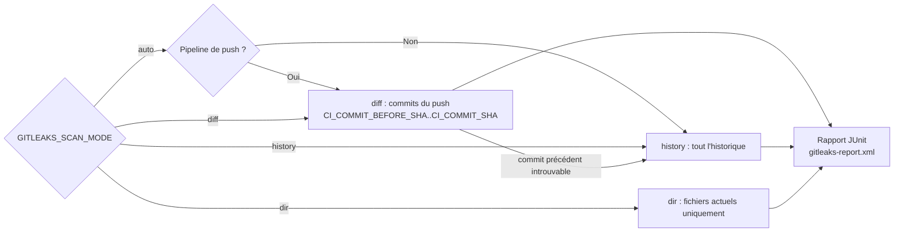

# Gitleaks module (détection de secrets)

Recherche les secrets committés par erreur dans le projet (tokens, mots de passe, clés privées, URLs de webhook...) avec [gitleaks](https://github.com/gitleaks/gitleaks). Comme le scan SonarQube, cette feature n'utilise aucun script Python de `cicd-script` : c'est un appel à l'exécutable `gitleaks` dans une image dédiée.

## Projets concernés

| Projet | Rôle dans la feature |
|------|----------------------|
| `cicd-yaml` | Définition du job (`features/gitleaks.yml`) |
| `cicd-docker` | Image utilisée par le job (`cicd-docker/gitleaks`, basée sur `zricethezav/gitleaks`), qui embarque le script `gitleaks_scan.sh` |
| Projet cible | Fichiers `.gitleaks.toml` et `.gitleaksignore` à la racine (optionnels, voir plus bas) |

## Fonctionnement



Le job `gitleaks-scan` (stage `quality`, avec `needs: []` : il démarre dès le début de la pipeline) :

1. Démarre l'image `${REGISTRY_DOMAIN}${CICD_NAMESPACE}${GITLEAKS_PATH}:${GITLEAKS_TAG}`.
2. Récupère tout l'historique git du projet (`GIT_DEPTH: "0"`).
3. Lance `/entrypoint/gitleaks_scan.sh`, qui choisit quoi scanner selon `GITLEAKS_SCAN_MODE` :
   - **`auto`** (défaut) : sur un push, seulement les commits du push. Pour un schedule, un lancement manuel ou un trigger, tout l'historique.
   - **`diff`** : seulement les commits entre `CI_COMMIT_BEFORE_SHA` et `CI_COMMIT_SHA`. Si le commit précédent est introuvable (par exemple après un force push), le script scanne tout l'historique à la place.
   - **`history`** : tout l'historique git.
   - **`dir`** : seulement les fichiers présents dans le dernier commit, sans l'historique.
4. Les secrets sont **masqués** dans les logs (`--redact`) : le log indique le fichier, la ligne, le commit et la règle déclenchée, mais jamais la valeur.
5. Le rapport `gitleaks-report.xml` (format JUnit) est publié en artefact. Les fuites apparaissent dans l'onglet **Tests** de la pipeline.
6. Le job est `allow_failure: true` : si un secret est trouvé, le job est en échec (orange) mais ne bloque pas le reste de la pipeline.

## Personnalisation par projet

gitleaks lit automatiquement ces fichiers s'ils sont à la racine du projet :

| Fichier | Rôle |
|---------|------|
| `.gitleaks.toml` | Règles personnalisées et allowlist (chemins, regex ou commits à ignorer). Pour garder les règles par défaut et y ajouter les siennes, mettre `[extend] useDefault = true` |
| `.gitleaksignore` | Liste d'empreintes (`Fingerprint`, affichée dans le log pour chaque fuite) à ignorer, une par ligne. C'est le moyen le plus simple d'écarter un faux positif |

Exemple de `.gitleaks.toml` :

```toml
[extend]
useDefault = true

[allowlist]
description = "Fichiers de test"
paths = ['''tests/fixtures/.*''']
```

## Que faire si un secret est trouvé ?

Supprimer le secret du code ne suffit pas : il reste dans l'historique git, et toute personne ayant accès au repo peut le récupérer.

1. **Révoquer ou régénérer le secret** à sa source (token GitLab, webhook, mot de passe...). C'est l'étape la plus importante.
2. Déclarer la nouvelle valeur en **variable CI/CD masquée** (projet ou groupe), plutôt que dans un fichier.
3. Ajouter l'empreinte de l'ancienne fuite dans `.gitleaksignore`, pour que les scans de l'historique ne la remontent plus.

## Déclenchement

Le job ne se lance que si `LAUNCH_FEATURE` contient `scan-secret-gitleaks`. La valeur n'est pas incluse par défaut. Elle peut être ajoutée ponctuellement via **Build > Pipelines > Run pipeline**, ou de façon permanente dans la configuration du projet (voir [Configuration par projet](../../README.md#configuration-par-projet)) :

```yaml
variables:
  LAUNCH_FEATURE: "build-docker,trigger-project,scan-code-sonarqube,scan-secret-gitleaks"
```

Pour scanner régulièrement tout l'historique, il est possible d'ajouter un schedule avec `LAUNCH_FEATURE: "scan-secret-gitleaks"` (en mode `auto`, un schedule scanne tout l'historique).

## Variables

| Variable | Défaut | Rôle |
|----------|--------|------|
| `GITLEAKS_PATH` | `cicd-docker/gitleaks` | Chemin de l'image dans le registry |
| `GITLEAKS_TAG` | `v8.28.0_1.0-prod` | Tag de l'image (`<version gitleaks>_<version image>`) |
| `GITLEAKS_SCAN_MODE` | `auto` | `auto`, `diff`, `history` ou `dir` (voir plus haut) |
| `GITLEAKS_EXTRA_ARGS` | vide | Arguments gitleaks supplémentaires (ex : `--max-target-megabytes 5`) |
| `GITLEAKS_REPORT_PATH` | `gitleaks-report.xml` | Chemin du rapport JUnit (défini dans le job, à ne pas modifier) |

## Résultat

Un job `gitleaks-scan` en succès si aucun secret n'est trouvé, en échec non bloquant sinon, avec le détail des fuites dans le log (valeurs masquées) et dans l'onglet **Tests** de la pipeline.

---
