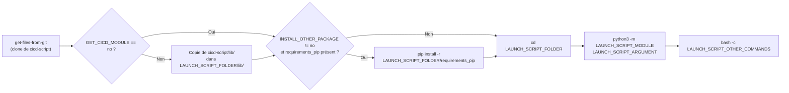

# Launch-script module

Bloc générique qui lance, à la demande, un module Python hébergé **dans le projet courant** (par exemple un script de backup, de synchronisation ou de reporting). Le script peut réutiliser la librairie commune `lib/` de `cicd-script` (appels API GitLab, requêtes HTTP, envoi de messages...) sans avoir à la copier dans son repo.

## Projets concernés

| Projet | Rôle dans la feature |
|------|----------------------|
| `cicd-yaml` | Définition du job (`features/launch-script.yml`) |
| `cicd-script` | Librairie commune (`lib/`) copiée à côté du script (optionnel) |
| `cicd-configuration` | Variables `LAUNCH_SCRIPT_*` du projet (`configuration/by_project/.<projet>-conf.yml`) et schedule de lancement (`setup/**/*.triggers.yml`) |
| Projet cible | Contient le script Python à lancer (ex : `script/main.py`) et, si besoin, son fichier `requirements_pip` |

Pour mettre en place la feature sur un projet, voir [docs/setup/LAUNCH_SCRIPT_SETUP.md](../setup/LAUNCH_SCRIPT_SETUP.md).

## Fonctionnement du job

1. Le job `get-files-from-git` (stage `prepare`) clone `cicd-script` (branche `CI_BRANCH_TO_PULL`) et le transmet en artefact. Le job `launch-python-script` dépend de lui (`needs`) et dispose donc à la fois du repo du projet courant et du dossier `cicd-script/`.
2. Le job tourne dans l'image `python-process` (`${REGISTRY_DOMAIN}${CICD_NAMESPACE}${PYTHON_PROCESS_PATH}:${PYTHON_PROCESS_TAG}`), qui contient déjà `requests`, `pyyaml`, `environs` et `jinja2`.
3. **Récupération de la librairie commune** : sauf si `GET_CICD_MODULE` vaut `no`, le dossier `cicd-script/lib/` est copié dans `<LAUNCH_SCRIPT_FOLDER>/lib/` (créé s'il n'existe pas). Le script peut alors faire `from lib.gitlab_helper import ...`. Si le projet a déjà un dossier `lib/`, les fichiers de cicd-script y sont ajoutés et **écrasent** ceux qui portent le même nom (`helper.py`, `gitlab_helper.py`, `global_vars.py`, `__init__.py`).
4. **Installation des dépendances** : si `INSTALL_OTHER_PACKAGE` ne vaut pas `no` et que le fichier `<LAUNCH_SCRIPT_FOLDER>/requirements_pip` existe, il est installé avec `pip` (directement dans l'image, aucun venv n'est créé). Sans ce fichier, l'étape est simplement ignorée.
5. Le job se place dans `LAUNCH_SCRIPT_FOLDER` puis lance `python3 -m ${LAUNCH_SCRIPT_MODULE} ${LAUNCH_SCRIPT_ARGUMENT}`. Le module est donc résolu depuis ce dossier : `LAUNCH_SCRIPT_MODULE: "main"` lance `<LAUNCH_SCRIPT_FOLDER>/main.py`, `"mon_package.main"` lance `<LAUNCH_SCRIPT_FOLDER>/mon_package/main.py`.
6. Enfin, `bash -c "${LAUNCH_SCRIPT_OTHER_COMMANDS}"` exécute des commandes shell supplémentaires (toujours depuis `LAUNCH_SCRIPT_FOLDER`). Si la variable est vide, rien n'est fait.

## Librairie commune disponible (`lib/`)

Quand `GET_CICD_MODULE` n'est pas à `no`, le script a accès aux modules suivants :

| Module | Contenu principal |
|--------|-------------------|
| `lib.global_vars` | Imports courants (`requests`, `yaml`, `json`, `logging`, `argparse`, `jinja2`...), objet `env` (`environs`), `GITLAB_URL` (construit avec `GITLAB_PROTOCOL` + `GITLAB_DOMAIN`), `ACCEPTED_STATUS_CODE` |
| `lib.helper` | `request()` (wrapper HTTP get/post/put/patch avec gestion d'erreur), `send_message()` (envoi d'un message vers un webhook), `get_changes()` (lecture des fichiers modifiés), `add_argument_to_conf()` |
| `lib.gitlab_helper` | Fonctions API GitLab : projets (`get_project_info`, `get_groups_project`, `get_branches`, `get_users`), issues (`get_issues`, `create_issue`, `update_issue`, `create_or_update_issue`, `create_issue_link`, `get_user_id`), registry (`get_registry_info`, `get_tags_in_repository`, `delete_tag_in_repository`...), variables CI et allowlists (`set_new_ci_variable`, `enable_allowlist`, `get_allowlist`...) |

## Prérequis

- Le projet doit utiliser `cicd-yaml` comme fichier de CI (configuré par le module [setup-project](SETUP_PROJECT.md)).
- `LAUNCH_SCRIPT_FOLDER` et `LAUNCH_SCRIPT_MODULE` doivent être définis (aucune valeur par défaut).
- Si `GET_CICD_MODULE` n'est pas à `no` et que le projet a son propre dossier `<LAUNCH_SCRIPT_FOLDER>/lib/`, éviter d'y mettre des fichiers portant le même nom que ceux de `cicd-script/lib/` (ils seraient écrasés).

## Déclenchement

Le job `launch-python-script` (stage `manage`) se lance uniquement si `LAUNCH_FEATURE` contient **`launch-python-script`**. Cette valeur n'est pas incluse par défaut. Elle est en général passée :

- par un **schedule** GitLab (cas le plus courant, ex : lancement quotidien ou mensuel), créé par le module setup-project ;
- ponctuellement via **Build > Pipelines > Run pipeline**, en ajoutant la variable `LAUNCH_FEATURE = launch-python-script`.

> **Attention :** si `launch-python-script` est mis dans `LAUNCH_FEATURE` au niveau de la configuration du projet, le script sera lancé **à chaque push**.

## Variables du job

| Variable | Défaut | Rôle |
|----------|--------|------|
| `LAUNCH_FEATURE` | `build-docker,trigger-project,...` | Doit contenir `launch-python-script` pour lancer le job |
| `LAUNCH_SCRIPT_FOLDER` | aucun | Dossier du script, relatif à la racine du projet (ex : `script`) |
| `LAUNCH_SCRIPT_MODULE` | aucun | Module Python lancé avec `python3 -m` depuis `LAUNCH_SCRIPT_FOLDER` (ex : `main`) |
| `LAUNCH_SCRIPT_ARGUMENT` | vide | Arguments passés au module (ex : `--project-id ${CI_PROJECT_ID} --token ${CICD_GMCD_TOKEN}`) |
| `LAUNCH_SCRIPT_OTHER_COMMANDS` | vide | Commandes shell lancées après le script (via `bash -c`) |
| `GET_CICD_MODULE` | (copie activée) | Mettre à `no` pour ne pas copier `cicd-script/lib/` |
| `INSTALL_OTHER_PACKAGE` | (installation activée) | Mettre à `no` pour ne pas installer `requirements_pip` même s'il existe |

Toutes les autres variables CI/CD (variables du projet, de la configuration `cicd-configuration` ou du schedule) sont accessibles par le script via `os.environ`.

## Résultat

Le module Python du projet est exécuté dans la pipeline, avec la librairie `cicd-script` à disposition, puis les éventuelles commandes complémentaires sont lancées. Le job échoue si le script ou une des commandes renvoie un code de sortie non nul.

---
